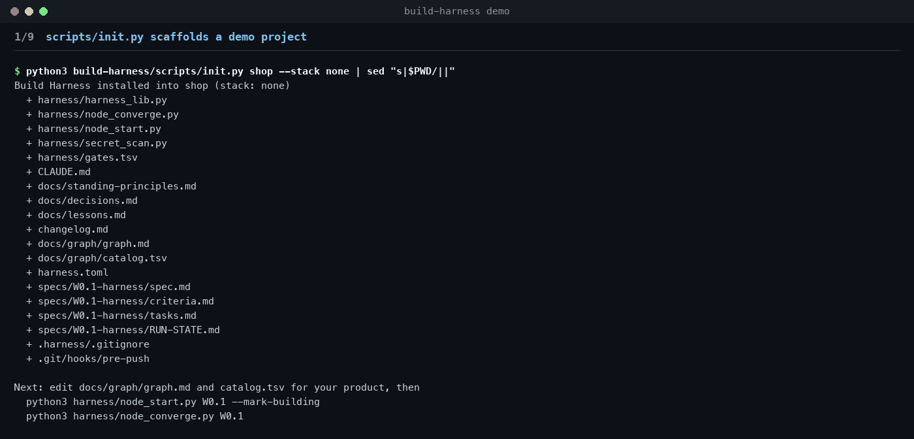

# Build Harness

**Gates, roles and memory for building real products with Claude Code.**
The agent writes the code; the harness makes sure it can't build ahead of a dependency, skip a test, push a secret, or make the same mistake twice.

[](https://github.com/biplob819/build-harness/blob/main/docs/walkthrough.md)

```text
/plugin marketplace add biplob819/build-harness
/plugin install build-harness@build-harness
/build-harness:init
```

It is the harness behind [Kova](https://kovahr.com) (an AI-native HR platform, 5,600+ commits), [Insightsflow](https://insightsflow.live) (embedded analytics), and eight public AI projects, each built node by node and scored with [EvalKit](https://github.com/biplob819/evalkit).

---

## The problem

Coding agents are fast and forgetful. A rule written in a prompt fades twenty turns later. "Done" is a claim, not a test result. A skipped test turns green. A solo builder can't review every diff, and the same class of bug comes back next week.

[Harness engineering](https://martinfowler.com/articles/harness-engineering.html) is the answer: build the environment around the agent so that every failure becomes a permanent control. Build Harness is one opinionated, working version of that, extracted from real use.

## How it works

Böckeler's framing splits a harness into **guides** (steer the agent before it acts) and **sensors** (check its work after), each either **computational** (deterministic) or **inferential** (another model judging):

|  | Computational | Inferential |
| --- | --- | --- |
| **Guides** (before) | Build graph: a node can't start until its dependencies are green (`node_start.py`). Spec folder per node: spec, criteria, tasks | Constitution (`CLAUDE.md`) and standing principles, re-injected on every prompt by a hook. The decision log, searched before any question |
| **Sensors** (after) | `node_converge.py`: claims-work, eligibility, proofs, secrets, your lint / types / tests / build, changed-tests, records. A pre-push guard that blocks `--no-verify`, force-pushes, and any push that fails a gate | The **verifier** agent: refutes every claim and finding from a fresh start. The **engineering-manager** agent: decides escalations and records why |

And one loop that turns mistakes into controls: a finding becomes a **lesson**, and a lesson that can be checked mechanically becomes a **gate**.

### The loop for one node

```text
node_start N1.2  ──►  failing tests first  ──►  build  ──►  node_converge N1.2 (all gates)
       │ GO only if every dependency is green                       │ any FAIL: fix the code, never the gate
       ▼                                                            ▼
  verifier: find ──► verifier: refute or confirm ──► builder: fix ──► verifier: re-run each repro
                                                                    │ clean
                                                                    ▼
                     rows flip green with proofs ──► changelog + run state ──► commit (no push)
```

### Proofs, not claims

A capability row in `docs/graph/catalog.tsv` goes green only with a proof for every dimension you configure (default: `logical`, `contract`, `safety`). Each proof names a real test, and the `proofs` gate parses the file to check that the test exists and isn't skipped:

```text
cap_id   node  status  proof
AUTH-02  N1.2  green   logical=tests/test_auth.py›"test_lockout_after_five_failures"; contract=tests/api.test.ts›"rejects expired token"; safety=n/a:no external input reaches this path
```

`n/a` needs a reason of at least ten characters, and `logical` can never be `n/a`.

## The three roles

| Agent | Does | Never does |
| --- | --- | --- |
| `builder` | One node or one fix batch at a time: tests first, build, converge, hand off, commit | Audit its own work, push, decide scope |
| `verifier` | Finder, verifier (refute by default), fix-verifier, synthesiser: one role per call, no memory between calls | Fix code, flip rows, trust someone else's evidence |
| `engineering-manager` | Decides engineering calls (approach, sequencing, dependencies, low-severity deferrals) and records them with the strongest argument against | Cut scope, touch anything irreversible or external, weaken a gate |

The owner decides only what is genuinely theirs: scope, irreversible changes, anything external. Questions come batched, with a recommendation first.

## Skills

| Skill | Use it to |
| --- | --- |
| `/build-harness:init` | Install the harness into a repo (never overwrites a file) |
| `/build-harness:build-node N1.2` | Run the whole loop for one node with the three agents |
| `/build-harness:converge N1.2` | Run every gate and explain each failure |
| `/build-harness:record-decision` | Add a numbered decision with context, options and the case against |
| `/build-harness:record-lesson` | Turn a mistake into a lesson with a control |
| `/build-harness:add-gate` | Add a gate, with proof that it fails on the mistake it exists for |

## What `init` puts in your repo

```text
CLAUDE.md                      constitution: the rules, the roles, where things live
harness.toml                   settings (proof dimensions, source and test globs); all optional
harness/                       node_start.py, node_converge.py, secret_scan.py, harness_lib.py, gates.tsv
docs/standing-principles.md    under 25 lines, re-injected every turn
docs/decisions.md              D-numbered decisions
docs/lessons.md                L-numbered lessons, each with its control
docs/graph/graph.md            the build graph: nodes and dependencies
docs/graph/catalog.tsv         one row per capability: status and proofs
specs/W0.1-harness/            spec, criteria, tasks, run state for the first node
.git/hooks/pre-push            secret scan + your pre-push gates, for humans too
```

Python 3.11+ and git. No other dependencies. Every script has a `--self-test` that proves its gates can fail.

Command gates are whatever your stack already uses, one per line in `harness/gates.tsv`:

```text
name   when      command
lint   both      ruff check .
types  converge  npx tsc --noEmit
tests  both      npm test
build  converge  npm run build
```

`init --stack python|node|go` pre-fills these.

## Field evidence

Measured with `scripts/evidence.py` (run it on your own repos to reproduce) across the ten repositories this harness built, on 16 Nov 2026:

| | |
| --- | --- |
| Commits | 13,040 across 10 repos, counted on each repo's main branch on 20 Nov 2026 (Kova 5,769 since March 2026; Insightsflow 6,300; the eight public AI projects 971) |
| Build-graph nodes | 185 across the eight public build graphs |
| Capability rows | 1,755, of which 748 are green with proofs |
| Decisions recorded | 1,751 |
| Lessons recorded | 286 |
| Pre-push gates on Kova | 33 |

Kova and Insightsflow are private; their counts come from the same script run locally. Insightsflow is built with a teammate, so its commits are the team's. The eight public repos are linked from [the portfolio](https://biplob819.github.io).

## How it relates to other tools

- **[Spec Kit](https://github.com/github/spec-kit)** gives you the spec-driven workflow (specify, plan, tasks). Build Harness adds what happens after the spec: dependency gates, proofs, an adversarial verifier and memory. They work well together; the Kova build used both.
- **[Superpowers](https://github.com/obra/superpowers)** is a methodology of skills. Build Harness is mostly enforcement: scripts that fail, and hooks that block.

## Limits

- The proofs gate parses Python tests fully; for other languages it finds the quoted test title and spots `.skip` / `xit` markers. It does not run the test; your command gates do.
- The secret scan is pattern-based and per push. Run [gitleaks](https://github.com/gitleaks/gitleaks) over full history before making a repo public.
- The verifier is only as good as its access: give it the real app, the real database and the real roles, not a mock.
- The loop costs tokens. An adversarial verify pass per node is the expensive part, and the part that catches what tests don't.

## Without the plugin

```bash
git clone https://github.com/biplob819/build-harness
python3 build-harness/scripts/init.py /path/to/your/repo --stack python
```

The scripts, templates and git hook work on their own; the plugin adds the agents, skills and the Claude Code hooks.

## Licence

Apache-2.0. See [LICENSE](LICENSE) and [NOTICE](NOTICE). Built by [Biplob Chakraborty](https://biplob819.github.io).
