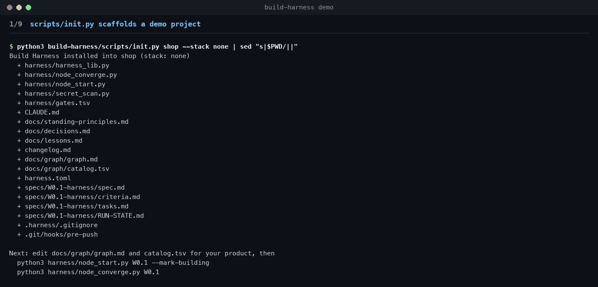

# Walkthrough

Nine terminal screens, about 2.5 to 3.5 seconds each, looping. Every screen is the real output of the command shown, run in a throwaway demo project (`shop`, a git repo with one empty commit) next to a clone of this repo (`build-harness`). Nothing is typed in by hand.

| # | What it shows | Command |
| --- | --- | --- |
| 1 | `init.py` scaffolds the demo project: harness scripts, constitution, logs, graph, catalog, first spec folder, pre-push hook | `python3 build-harness/scripts/init.py shop --stack none \| sed "s\|$PWD/\|\|"` (the `sed` only shortens the absolute path) |
| 2 | The demo's build graph (W0.1 → N1.1 Cart → N1.2 Checkout), its capability catalog, and one command gate | `grep '^\| \*\*' docs/graph/graph.md`, `cat docs/graph/catalog.tsv`, `grep -v '^#' harness/gates.tsv` |
| 3 | The dependency gate: N1.1 is refused because W0.1 is not green | `python3 harness/node_start.py N1.1` |
| 4 | W0.1 has no dependencies, so it starts: baseline recorded, rows flipped to building | `python3 harness/node_start.py W0.1 --mark-building` |
| 5 | Converge fails on a named defect: the green row's proof cites a test marked `@unittest.skip`, which the tests gate alone would let through | `grep -n -A1 'skip' tests/test_w01.py`, `python3 harness/node_converge.py W0.1` |
| 6 | The skip is removed and all seven gates pass | `sed -i '' '/unittest.skip/d' tests/test_w01.py`, `python3 harness/node_converge.py W0.1` |
| 7 | With W0.1 green, the dependent node N1.1 may start | `python3 harness/node_start.py N1.1` |
| 8 | `--self-test` proves each structural gate can fail | `python3 harness/node_converge.py --self-test` |
| 9 | `evidence.py` measures the demo project from git and the harness files | `git add -A && git commit -q -m 'W0.1: harness green' && git log --oneline \| cat`, `python3 ../build-harness/scripts/evidence.py .` |

## Off-camera steps

These are the edits `init.py` tells you to make next ("edit docs/graph/graph.md and catalog.tsv for your product"):

- After screen 1: replaced the template graph and catalog with the three-node demo (W0.1, N1.1 Cart, N1.2 Checkout), added `specs/N1.1-cart/` (spec, criteria, tasks), added a `tests` row to `harness/gates.tsv` (`python3 -m unittest discover -s tests -q`), and committed.
- After screen 4: wrote `tests/test_w01.py` (one test runs the three `--self-test`s, one checks the gates file header; the first was left with `@unittest.skip`) and flipped `HAR-01` to green with a proof citing both tests.

## Reproducing it

The capture script builds the demo from scratch, runs each command and saves its output; a second script draws each output as a terminal frame (Menlo 15 px, dark theme) and joins them into a GIF with Pillow. The text in the frames is the captured output, unedited. Colour is added only to status words (PASS, FAIL, GO, DO NOT START, ok, skip).
